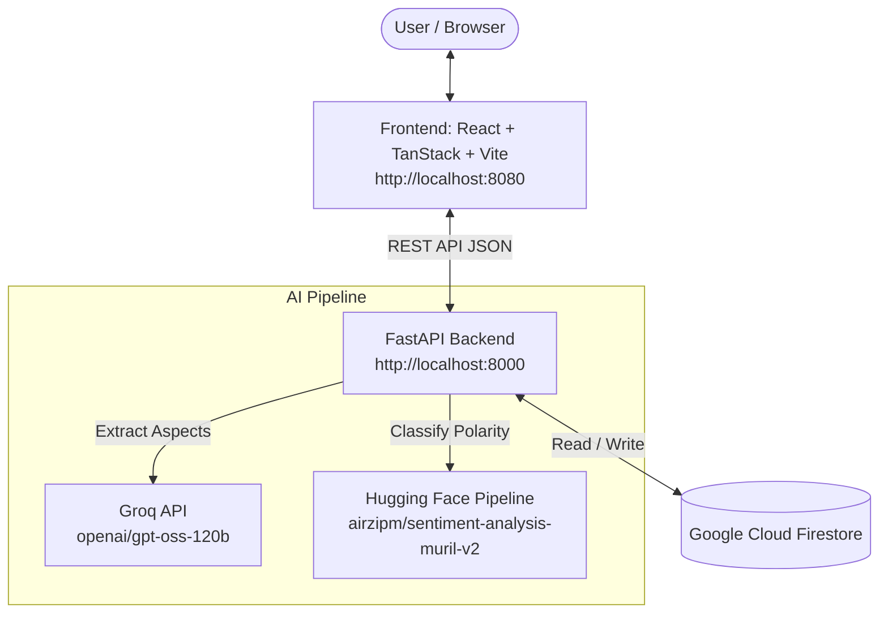

# 🛍️ Multilingual Product Sentiment Analysis Platform

An end-to-end, aspect-based sentiment analysis platform for e-commerce products supporting **English, Hindi, and Hinglish** reviews. Built with **FastAPI**, **React (Vite + TanStack Router)**, **Firebase Firestore**, **Groq LLM inference**, and a fine-tuned **MuRIL Transformer model**.

---

## 🌟 Key Features

- **Aspect-Based Sentiment Analysis (ABSA)**: Deconstructs compound customer reviews (e.g., *"Camera quality is great but battery life drains fast"*) into distinct product aspects using high-speed Groq LLM inference.
- **Multilingual Support**: Supports reviews written in English, Hindi (Devanagari script), and Hinglish (Romanized Hindi).
- **Transformer-Powered Classification**: Leverages [`airzipm/sentiment-analysis-muril-v2`](https://huggingface.co/airzipm/sentiment-analysis-muril-v2) for granular Positive, Neutral, and Negative polarity classification with confidence scoring.
- **Admin & Customer Dashboards**: Role switcher allowing admins to add/delete products and analyze review distributions, while customers browse products and submit feedback.
- **Interactive Visualizations**: Real-time aggregate ratings, sentiment color-coded badges (Green = Positive, Slate = Neutral, Red = Negative), and detailed aspect breakdowns.
- **Serverless Cloud Storage**: Real-time persistence and querying with Google Cloud Firestore.

---

## 🏗️ Architecture & Data Flow



---

## 🛠️ Tech Stack

- **Backend**:
  - Python 3.10+
  - [FastAPI](https://fastapi.tiangolo.com/) & [Uvicorn](https://www.uvicorn.org/)
  - [Hugging Face Transformers](https://huggingface.co/transformers/) & [PyTorch](https://pytorch.org/)
  - [Groq Python SDK](https://console.groq.com/)
  - [Firebase Admin SDK](https://firebase.google.com/docs/admin/setup)
  - [Pydantic v2](https://docs.pydantic.dev/) & [python-dotenv](https://github.com/theskumar/python-dotenv)
- **Frontend**:
  - TypeScript & React 18+
  - [Vite](https://vitejs.dev/)
  - [TanStack Router](https://tanstack.com/router)
  - [Tailwind CSS](https://tailwindcss.com/) & [Radix UI / Shadcn](https://ui.shadcn.com/)
  - Lucide Icons & Sonner notifications
- **Database**:
  - Google Firebase Firestore

---

## 📋 Prerequisites

Before running the project, ensure you have:

1. **Python 3.10+** installed ([python.org](https://www.python.org/downloads/))
2. **Node.js 18+** & **npm** installed ([nodejs.org](https://nodejs.org/))
3. **Groq API Key**: Obtain a free API key at [console.groq.com](https://console.groq.com/)
4. **Firebase Project**:
   - Create a project on [Firebase Console](https://console.firebase.google.com/)
   - Enable **Firestore Database** in test mode or with appropriate security rules
   - Go to **Project Settings** > **Service accounts** > **Generate new private key** (downloads a `.json` file)

---

## 🚀 Step-by-Step Setup Guide

### 1. Clone the Repository

```bash
git clone https://github.com/Maverick572/sentiment-analysis.git
cd sentiment-analysis
```

---

### 2. Configure Environment Variables

Create your `.env` file in the project root by copying the template:

```bash
cp .env.example .env
```

Open `.env` and fill in your configuration:

```env
# Required: Groq API Key
GROQ_API_KEY=gsk_your_actual_groq_api_key_here

# Optional: Aspect extraction model (default: openai/gpt-oss-120b)
GROQ_ASPECT_MODEL=openai/gpt-oss-120b

# Optional: Path to Firebase credentials JSON
FIREBASE_CREDENTIALS_PATH=backend/your-firebase-adminsdk.json

# Optional: Allowed origins for CORS
FRONTEND_ORIGINS=http://localhost:3000,http://localhost:5173,http://localhost:8080
```

---

### 3. Add Firebase Service Account Key

Place your downloaded Firebase service account JSON key into the `backend/` directory:

```
backend/
└── your-project-firebase-adminsdk-xxxxx.json
```

*(The backend will automatically detect any file ending in `*firebase-adminsdk*.json` in the `backend/` directory, or you can specify its exact path via `FIREBASE_CREDENTIALS_PATH` in `.env`).*

> ⚠️ **Security Notice**: Firebase private key JSON files and `.env` are listed in `.gitignore` and must **never** be committed to version control.

---

### 4. Setup and Run Backend

Open a terminal at the project root:

```bash
# 1. Create a Python virtual environment
python -m venv venv

# 2. Activate the virtual environment
# On Windows (PowerShell):
.\venv\Scripts\Activate.ps1
# On Windows (Command Prompt):
.\venv\Scripts\activate.bat
# On macOS/Linux:
source venv/bin/activate

# 3. Install required dependencies
pip install -r requirements.txt

# 4. Start the FastAPI server
uvicorn backend.main:app --host 0.0.0.0 --port 8000 --reload
```

> 💡 **First Run Note**: On initial startup, the backend automatically downloads the `airzipm/sentiment-analysis-muril-v2` Hugging Face model weights (~500 MB). Subsequent runs will load from cache instantly.

Verify the backend is running by visiting:
- Health check: [http://localhost:8000/health](http://localhost:8000/health)
- Swagger interactive API docs: [http://localhost:8000/docs](http://localhost:8000/docs)

---

### 5. Setup and Run Frontend

In a separate terminal, navigate to the `frontend/` directory:

```bash
cd frontend

# 1. Install dependencies
npm install

# 2. (Optional) Configure environment
# Defaults to http://localhost:8000. Create frontend/.env.local if you wish to override:
# echo "VITE_API_BASE_URL=http://localhost:8000" > .env.local

# 3. Start development server
npm run dev -- --port 8080
```

Open your browser and navigate to:
👉 **[http://localhost:8080](http://localhost:8080)** (or `http://localhost:5173`)

---

## 📡 API Reference

Interactive OpenAPI documentation is available at `http://localhost:8000/docs`.

| Method | Endpoint | Description | Request Body |
|--------|----------|-------------|--------------|
| `GET` | `/health` | Check API and model health status | None |
| `GET` | `/products` | Retrieve all products with ratings | None |
| `POST` | `/products` | Create a new product (Admin) | `{ "name": "...", "price": 99.99, "image": "https://..." }` |
| `GET` | `/products/{product_id}` | Retrieve single product with full review history & aspect breakdowns | None |
| `DELETE` | `/products/{product_id}` | Delete a product (Admin) | None |
| `POST` | `/products/{product_id}/reviews` | Submit review text, trigger aspect extraction & sentiment analysis | `{ "text": "Great screen but poor battery", "rating": 4 }` |

### Sample Review Analysis Output

When a review is submitted:
```json
{
  "success": true,
  "review": {
    "text": "Display is sharp and vibrant, lekin battery backup bohot kharab hai.",
    "rating": 3.0,
    "created_at": "2026-10-18T14:30:00Z",
    "aspects": [
      {
        "aspect": "Display",
        "segment": "Display is sharp and vibrant",
        "sentiment": "positive",
        "confidence": 0.9842
      },
      {
        "aspect": "Battery backup",
        "segment": "lekin battery backup bohot kharab hai",
        "sentiment": "negative",
        "confidence": 0.9615
      }
    ]
  }
}
```

---

## 📁 Repository Structure

```
sentiment-analysis/
├── .env.example               # Root environment configuration template
├── .gitignore                  # Git ignore rules (secrets, venv, caches)
├── README.md                   # Project documentation
├── requirements.txt            # Python dependencies
├── backend/
│   ├── .env.example            # Backend-specific environment template
│   ├── __init__.py             # Python package marker
│   ├── create_product.py       # Firestore product creation handler
│   ├── create_review.py        # Groq aspect extraction & MuRIL sentiment pipeline
│   ├── firebase_db.py          # Firebase Admin Firestore initialization
│   ├── main.py                 # FastAPI application, routing, CORS & lifespan
│   └── view_product.py         # Firestore product listing, retrieval & deletion
└── frontend/
    ├── .env.example            # Frontend environment template
    ├── package.json            # Node.js dependencies and scripts
    ├── vite.config.ts          # Vite configuration
    ├── src/
    │   ├── components/         # React components (RoleSwitch, Sentiment, UI)
    │   ├── lib/                # API client, store, and sentiment helpers
    │   ├── routes/             # TanStack file-based routes
    │   │   ├── index.tsx       # Products catalog & management view
    │   │   └── products.$id.tsx# Product detail & review analysis view
    │   └── styles.css          # Styling & theme variables
```

---

## ❓ Troubleshooting

<details>
<summary><b>1. Firebase Admin initialization error / FileNotFoundError</b></summary>

Make sure your Firebase service account private key JSON file is downloaded and placed inside the `backend/` folder, or set the exact path in your `.env` file:
```env
FIREBASE_CREDENTIALS_PATH=backend/your-firebase-adminsdk.json
```
Verify that Firestore is enabled in your Firebase Console.
</details>

<details>
<summary><b>2. Groq API authentication error (401 / Invalid Key)</b></summary>

Ensure `GROQ_API_KEY` is present in your root `.env` or system environment variables. You can test your key directly with:
```bash
curl https://api.groq.com/openai/v1/models -H "Authorization: Bearer $GROQ_API_KEY"
```
</details>

<details>
<summary><b>3. PyTorch / Transformers model download issues</b></summary>

On slow network connections, the first download of `airzipm/sentiment-analysis-muril-v2` may take a few minutes. Ensure you have at least 1 GB of free disk space in your user cache (`~/.cache/huggingface`).
</details>

<details>
<summary><b>4. CORS error between frontend and backend</b></summary>

The backend permits local loopback origins (`localhost` and `127.0.0.1` on any port) by default. If running across a custom host or domain, add it to `FRONTEND_ORIGINS` in `.env`:
```env
FRONTEND_ORIGINS=http://localhost:8080,http://my-custom-domain.com
```
</details>

---

## 📜 License

This project is open-source and available under the [MIT License](LICENSE).
